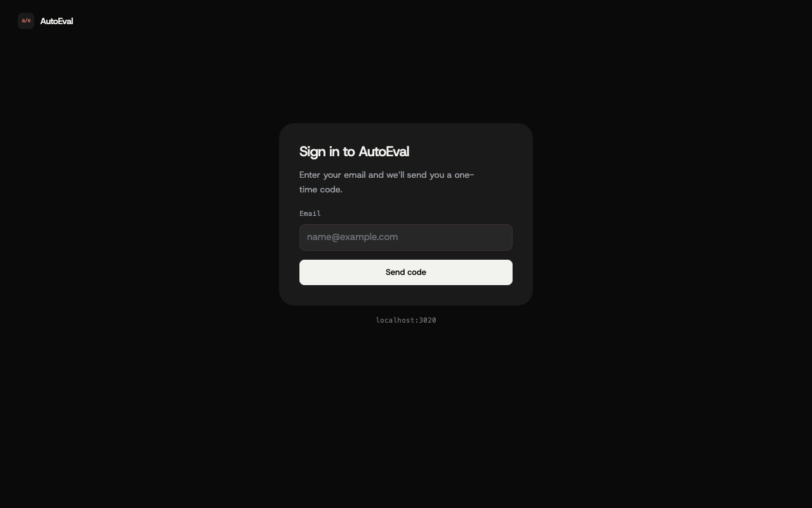
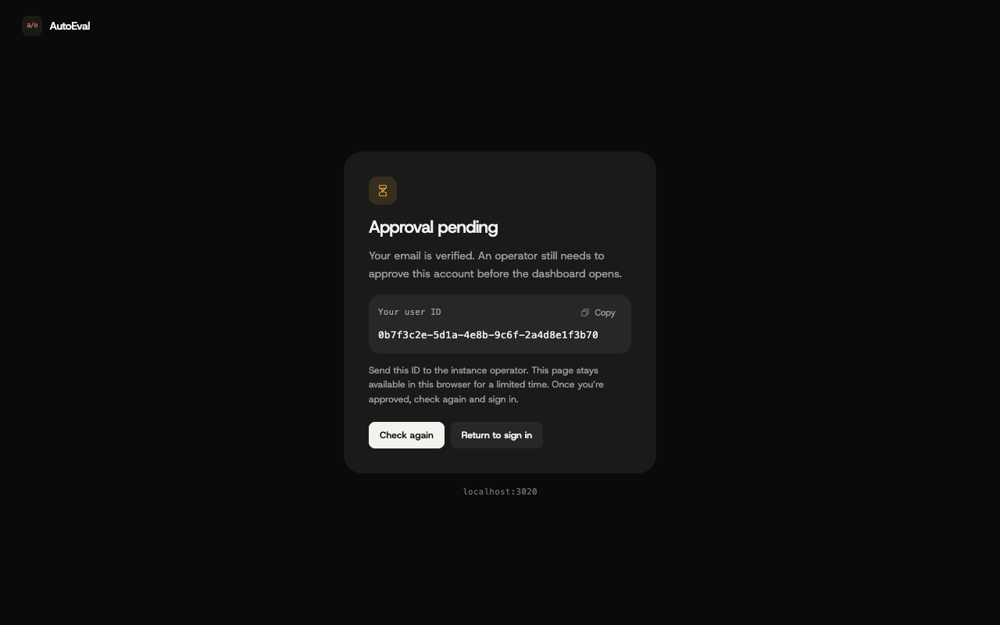
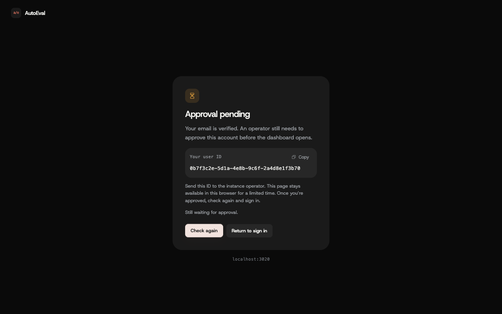
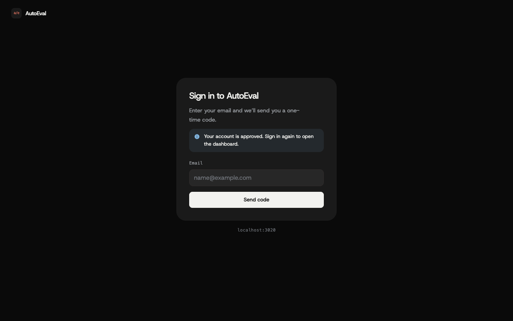
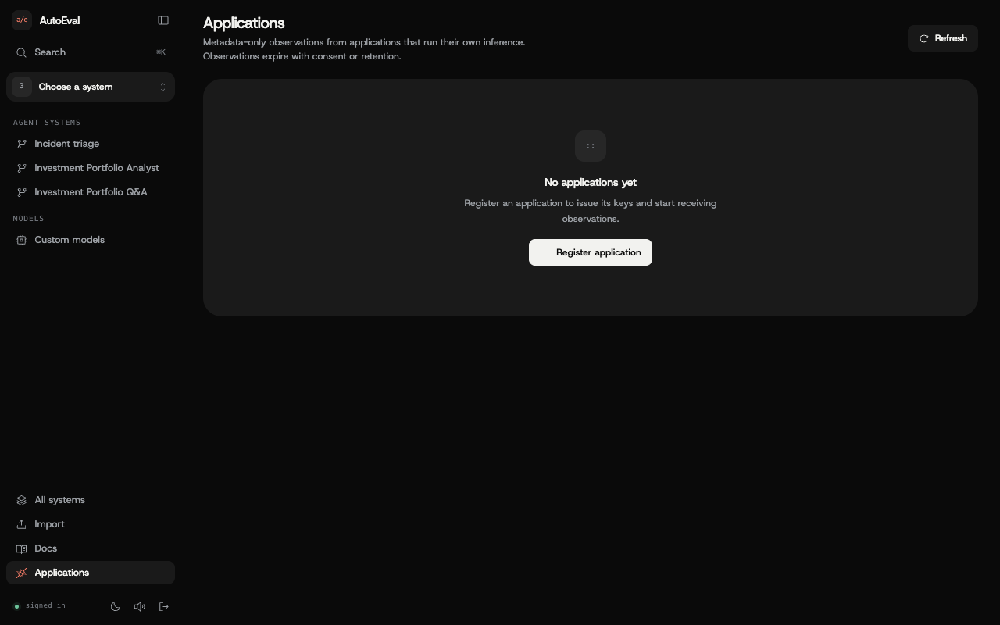
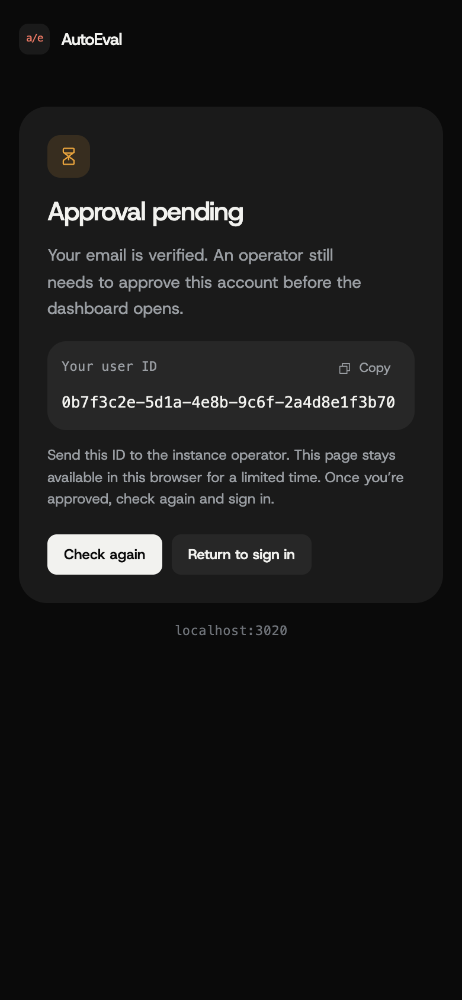

# PR #35 evidence: pending approval survives a reload (synthetic)

Evidence only. This orphan branch is never merged; delete it any time with
`git push origin --delete evidence/pr-35-pending-refresh`.

All screenshots are **synthetic**. Real Chrome 157 with real cookies, a local production build
(`next start`) proxying `/api/backend` to the real hosted backend in Supabase mode, and a throwaway
HTTPS stub identity provider. The stub's signing key is generated per run, and the identity is invented:
`pending.user@example.test` / `0b7f3c2e-5d1a-4e8b-9c6f-2a4d8e1f3b70`. No real provider, mailbox,
database, deployment, or allowlist was used.

Captured on PR head `335f02d46240006158b504552a587c97974b111c` (macOS arm64, 2026-11-15).

| # | State | What was verified |
|---|---|---|
| 01 | Signed out | `/auth/session` 401; cookie-less pending check answers `{authenticated:false}` |
| 02 | Verified, awaiting approval | Only cookie: `__Host-autoeval-pending` (HttpOnly, Secure, SameSite=Strict, ~900 s). `/auth/session`, `/catalog`, `/applications`, `/auth/logout` all 401 |
| 03 | After full reload | Same server-verified UUID shown; no sidebar; localStorage and sessionStorage empty |
| 04 | Check again | Still pending, announced in a live region |
| 05 | Approved, then reload | Pending record consumed, no session created, fresh sign-in requested, no cookies |
| 06 | Approved sign-in | `__Host-autoeval` session; `/auth/session` 200; survives reload |
| 07 | Revoked, then reload | Existing session rejected; sign-in, no UUID, no workspace |
| 08 | Phone width, after reload | Pending state at 390 px |

Also checked without a screenshot: a second browser, and one with forged pending/session cookies, saw sign-in only and no UUID. Return to sign in cleared the record, and a reload stayed at sign-in.

